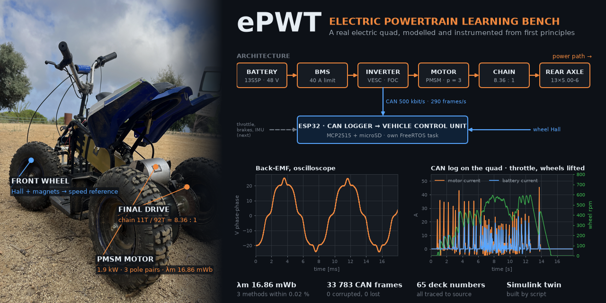

# ePWT — Electric Powertrain Learning Bench



An electric mini-quad used as a hands-on learning platform for power electronics,
electric machines, control and model-based development.

The hardware exists and runs (PMSM motor, VESC inverter, 13S5P Li-ion pack, BMS,
ESP32). This project is not about building the vehicle — it is about **modelling,
controlling, instrumenting and understanding it from first principles**.

Structure: a Simulink digital twin parameterised from measured hardware, validated
against real test data, driving control development that is later deployed to the
embedded target.

Work runs in two-week cycles, each closed by a review with engineering mentors.

This repository is published from the author's private workspace and is updated after
each reviewed change, with its full commit history.

## What has been shown so far

| Result | Number | Evidence |
|---|---|---|
| Motor characterised without a reliable datasheet | 3 pole pairs (25 Hall pulses vs 25.1 predicted); magnet flux λm = 16.86 mWb, three methods agree within 0.02 % | [`03_hardware/motor-parameters.md`](03_hardware/motor-parameters.md), [`01_plan/cycles/closed/C00.md`](01_plan/cycles/closed/C00.md) |
| The inverter's own motor estimate is off | VESC estimate 15.92 mWb, 5.5 % below the measurement; gear ratio (1 → 8.364) and pole count (14 → 6) corrected in its configuration | [`03_hardware/vesc/`](03_hardware/vesc/), [`01_plan/cycles/closed/C00.md`](01_plan/cycles/closed/C00.md) |
| Longitudinal vehicle model, predictions frozen before measuring | Two fidelity levels in Simulink, built by script, L1 = L2 regression exact | [`01_plan/cycles/closed/C01.md`](01_plan/cycles/closed/C01.md), [`04_model/`](04_model/) |
| Every number in a review deck traced to its source | 65 figures audited automatically, 0 without an origin | [`01_plan/cycles/closed/C01.md`](01_plan/cycles/closed/C01.md) |
| CAN logger for the inverter, on the vehicle under throttle | 137 s, 33 783 frames, peaks of 49 A: 0 corrupted frames, 0 SPI errors, 0 overflows | [`05_firmware/arduino/can_logger/`](05_firmware/arduino/can_logger/), [EXP-002](07_experiments/EXP-002-spi-noise-can-logger.md) |

What went wrong is written down too: an ESP32 destroyed by a ground loop between the
inverter and the PC is an open experiment with a hypothesis and a method
([EXP-001](07_experiments/EXP-001-ground-loop-vesc-pc.md)).

## Where to start

1. [`START-HERE.md`](START-HERE.md): the current cycle and what is being done now.
2. [`08_decisions/`](08_decisions/): why things are the way they are, with the discarded
   alternatives. The latest is the vehicle control unit architecture
   ([DEC-005](08_decisions/DEC-005-vcu-architecture.md)).
3. [`05_firmware/arduino/can_logger/`](05_firmware/arduino/can_logger/): embedded C++ on the
   ESP32, one job per module, with its acceptance test and result in the README.

Everything is in English: plans, notes, experiments, decisions, code, commits and decks.

## How the work is done

- **Two-week cycles**, each closed by a review with engineering mentors.
- **Measure before modelling, predict before measuring.** Numbers without a source do not
  go into a deck.
- **AI-assisted software, human-owned contracts.** Code is written with an AI coding agent;
  the module contract and the acceptance test, with its number, are written by the author
  before the code exists.
- **Every change goes through a branch and a pull request** in the private workspace; this
  repository receives what has been merged, with its full history.

## Repository

| Path | Contents |
|---|---|
| `00_system/` | Requirements with IDs and numbers, and how each one is verified (light V cycle) |
| `01_plan/` | Two-week work cycles, the task list, the learning app, roadmap, long-term direction, deferred scope |
| `02_knowledge/` | Engineering notes and the mistakes log |
| `03_hardware/` | Vehicle specs, measured parameters, inverter configuration, EMC study |
| `04_model/` | Simulink model — digital twin, parameters, analysis scripts, results |
| `05_firmware/` | Embedded code (ESP32 / Arduino) and the vehicle control unit board design |
| `06_data/` | Test campaigns, one folder per run: `YYYY-MM-DD_<test>` |
| `07_experiments/` | Hypothesis, measurement, conclusion |
| `08_decisions/` | Engineering decisions and discarded alternatives |
| `09_reviews/` | Mentor review decks, the scripts that build them, and their images |

## Toolchain

<details>
<summary><b>MATLAB and Simulink from the coding agent (MCP)</b>: setup and pitfalls</summary>


Simulink is driven from an AI coding agent through the MathWorks
[Simulink Agentic Toolkit](https://github.com/matlab/simulink-agentic-toolkit),
which runs on top of the
[MATLAB MCP Server](https://github.com/matlab/matlab-mcp-server).

The agent reads model structure, queries parameters and runs simulations. It does
**not** place or wire blocks — see rule 4 in `04_model/CLAUDE.md` for why.

**Daily use.** Open MATLAB first, then the agent from this directory.
`~/Documents/MATLAB/startup.m` opens the bridge automatically. The server attaches
to an *existing* MATLAB session, so MATLAB must already be running: if the agent
starts first it will fail with `failed to attach to MATLAB session` and needs a
restart. To check the bridge from a session, run `feature('getpid')` — a reply
means it is up.

**Regenerating the configuration.** `.mcp.json` is committed, but it holds
absolute paths that are specific to one machine and one user account. Do not edit
it by hand on a new machine — regenerate it.

Prerequisites: MATLAB R2023a or later with Simulink, plus
`agenticToolkitInstaller.mltbx` from the toolkit's GitHub releases, installed as a
MATLAB add-on. Then, in MATLAB:

```matlab
setupAgenticToolkit("install", Toolkit=["matlab","simulink"], Prompt=false)
cd <this repository>
setupAgenticToolkit("configure", Toolkit=["matlab","simulink"], ...
    Agents="claude-code", Scope="project", DisableTelemetry=true, Prompt=false)
```

Two things that are easy to get stuck on:

- If the agent binary is not on `PATH`, autodetection fails silently. Pass it
  explicitly: `AgentCLI="claude-code=/full/path/to/claude"`.
- The project MCP server must be approved before it will start. Approval lives in
  `.claude/settings.local.json`, which is machine-local and not committed. Some
  clients never show the approval prompt; in that case write it by hand:
  `{"enabledMcpjsonServers": ["matlab"]}`.

Finally, add `satk_initialize` to `startup.m` so the bridge opens on every MATLAB
launch rather than by hand.

</details>
